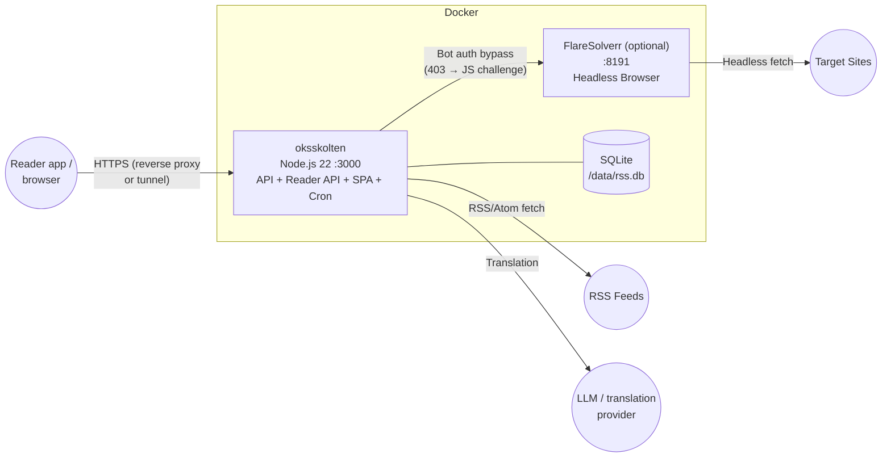

# Oksskolten Spec — Overview

A self-hosted feed backend with a small management UI. A single Docker container handles API, SPA serving, and cron jobs. Deployable on any Docker-capable environment — NAS, VPS, cloud VM, etc.

Typical RSS readers only display the title and summary provided by the feed, requiring users to visit the original site to read the full article. Oksskolten fetches full text directly from the article's source URL, extracting and storing the content using Readability + 500 cleaner patterns. Everything — from reading articles to AI summaries, translation, and search — is self-contained within Oksskolten.

> **Fork note.** This is the `leeclissett/oksskolten` hard fork of `babarot/oksskolten`. Its job is to be a FreshRSS-dialect Reader API backend with full-text extraction and translation. Removed from upstream: chat and the MCP server, summaries, LLM-inferred CSS selectors, RSS-Bridge, Meilisearch search, similarity detection and scoring, GitHub OAuth and passkeys, the demo build, the PWA, themes and fonts, the mascot, keyboard navigation and swipe gestures. The Reader API is specified in [../greader-compat.md](../greader-compat.md).

> This document provides a spec overview. See the following for details:
>
> - [10_schema.md](./10_schema.md) — SQLite Schema
> - [20_api.md](./20_api.md) — API Spec
> - [30_ingestion.md](./30_ingestion.md) — Article Ingestion Pipeline & Error Handling
> - [40_auth.md](./40_auth.md) — Authentication
> - [50_frontend.md](./50_frontend.md) — Frontend (Routing, Data Fetching)
> - [80_feature_clip.md](./80_feature_clip.md) — Clip
> - [81_feature_images.md](./81_feature_images.md) — Image Archive
> - [85_feature_ollama.md](./85_feature_ollama.md) — Ollama LLM Provider
> - [90_perf_retry_backoff.md](./90_perf_retry_backoff.md) — Exponential Backoff for Article Retry

## Tech Stack

| Layer | Technology |
|---|---|
| Runtime | Node.js 22 + Fastify (Docker) |
| DB | SQLite (libsql driver). Local file (WAL mode). Also supports Turso Cloud |
| Frontend | React 19 + Vite + React Router + SWR |
| Styling | Tailwind CSS (`darkMode: 'class'`, following the system colour scheme) |
| Markdown | marked.js (`{ gfm: true, breaks: true }`) + DOMPurify (default `ALLOWED_TAGS`, `<iframe>` excluded) |
| RSS Parsing | feedsmith (uses fast-xml-parser internally). Supports RSS 2.0 / Atom 1.0 / RSS 1.0 (RDF). Falls back to direct fast-xml-parser only when feedsmith fails |
| Full-text Extraction | @mozilla/readability + jsdom + turndown + HTML cleaner (defuddle-based, local processing). Runs in piscina Worker Threads (does not block the main event loop) |
| Language Detection | TinyLD local processing (62 languages, no API needed) |
| Translation | Selectable from Anthropic / Gemini / OpenAI / Claude Code / Ollama / vLLM / Google Translate / DeepL. Manual translation is streaming-capable; feeds can also queue non-English articles for serial background translation to English |
| Authentication | JWT (`@fastify/jwt`) + bcryptjs (password auth) + API tokens + Reader API ClientLogin |
| Rate Limiting | `@fastify/rate-limit` (applied to auth endpoints) |
| Deployment | `docker compose up -d` (NAS, VPS, cloud VM, etc.) |

## Deployment Architecture

The app is a single container with one volume (`/data`). FlareSolverr is optional. How the container is exposed (reverse proxy, Cloudflare Tunnel) is outside this repository.

### Environment Variables (.env)

All variables are optional (runs with a local SQLite file).

| Variable | Purpose | Required | Notes |
|---|---|---|---|
| `DATABASE_URL` | DB connection | | Defaults to `file:./data/rss.db` (local file, WAL mode). Supports Turso Cloud with `libsql://...` |
| `TURSO_AUTH_TOKEN` | Turso auth token | | Only needed when `DATABASE_URL` is `libsql://` |
| `JWT_SECRET` | JWT signing secret | | Auto-generated on first startup and persisted in DB if not set |
| `PORT` | Server port | | Default `3000` |
| `FLARESOLVERR_URL` | FlareSolverr URL | | e.g. `http://flaresolverr:8191`. Bot auth bypass disabled if not set |
| `AUTH_DISABLED` | `1` to skip auth | | Only effective when `NODE_ENV=development` |
| `FLARESOLVERR_CONCURRENCY` | Max concurrent FlareSolverr requests | | Unlimited if not set |
| `FETCH_CONCURRENCY` | Article fetch concurrency (semaphore) | | Default `5` |
| `PARSE_MAX_THREADS` | DOM parsing Worker Thread count (piscina) | | Default `2` |
| `CRON_SCHEDULE` | Feed fetch cron expression | | Default `*/5 * * * *` (every 5 min) |
| `LOG_LEVEL` | Pino log level | | Default `info` |
| `OLLAMA_BASE_URL` / `VLLM_BASE_URL` | Default base URLs for the local LLM providers | | Can also be set in the settings UI |
| `NO_SEED` | `1` to skip development seed data | | Only relevant when `NODE_ENV=development` |
| `GIT_COMMIT` | Git commit SHA at build time | | Returned in `/api/health`. Defaults to `'dev'` |
| `GIT_TAG` | Git tag at build time | | Returned in `/api/health`. Defaults to `'dev'` |
| `BUILD_DATE` | Build date (ISO 8601) | | Returned in `/api/health` |
| `VITE_API_PROXY_TARGET` | Vite dev API proxy target | | Default `http://127.0.0.1:3000` |
| `VITE_PORT` | Vite dev server port | | Default `5173` |

> **Note:** AI provider API keys (Anthropic / Gemini / OpenAI / DeepL) and JWT secret are managed in the DB `settings` table, not as environment variables. API keys can be configured via the settings UI (`/settings/integration`).

### Key Components

| Component | Files | Overview |
|---|---|---|
| **Fetcher Pipeline** | `server/fetcher/` | RSS parsing (2.0/Atom/RDF), Readability full-text extraction, HTML cleaner (400+ patterns), Markdown conversion, image archiving. DOM parsing runs in piscina Worker Threads (max 2) to protect the event loop |
| **AI Providers** | `server/providers/llm/` | Unified `LLMProvider` interface — Anthropic, Gemini, OpenAI, Claude Code, Ollama, vLLM (used for translation only) |
| **Translation** | `server/providers/translate/` | Google Cloud Translation API v2 / DeepL (alternative to LLM translation) |
| **HTML Cleaner** | `server/lib/cleaner/` | 3-phase pipeline: pre-clean → Readability → post-clean (selector-based, scoring-based, normalization) |
| **Auth** | `server/auth*.ts` | JWT + bcryptjs, API tokens |
| **Reader API** | `server/routes/greader*.ts` | FreshRSS-dialect Google Reader API |
| **Frontend** | `src/` | React SPA — feed management, article view and settings, SWR data fetching |

For details on system internals, data flow, and design decisions, see [02_architecture.md](./02_architecture.md).
