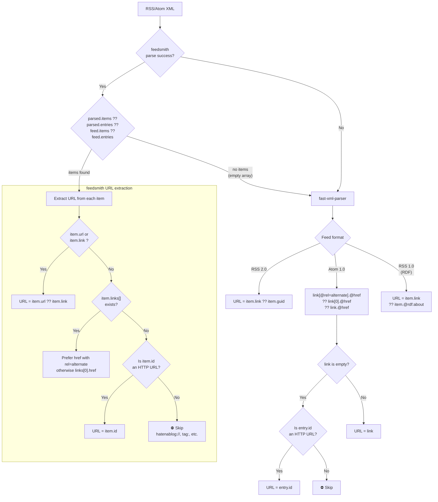
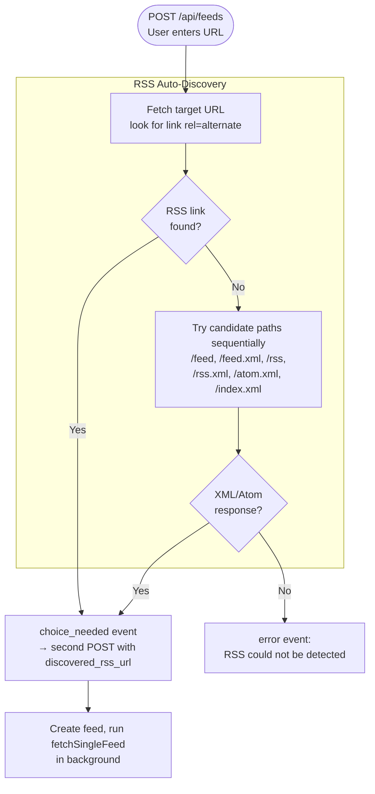

# Oksskolten Spec — Article Ingestion Pipeline

> [Back to Overview](./01_overview.md)

## Article Ingestion Pipeline

### Design Philosophy: Full-Text Retrieval Beyond RSS Feeds

Typical RSS readers (FreshRSS, CommaFeed, etc.) display RSS feed XML content (`content:encoded`, `description`) as-is. Since many feeds provide only a title and a few lines of summary, reading the full text requires navigating to the original site.

Oksskolten **fetches HTML directly from the original URL for every article** and extracts the full text using Readability. This provides:

- **Self-contained reading experience**: No need to navigate to the original site to read articles
- **Higher quality translation**: Translations are based on the complete article body, not RSS fragments
- **Complete bodies for reader apps**: The Reader API serves the extracted full text instead of the feed fragment

> Only Miniflux optionally has a Readability-based Crawler feature, but it requires manual per-feed activation. Oksskolten performs full-text retrieval by default for all articles.

### Cron Processing Flow

Cron runs at 5-minute intervals (`*/5 * * * *`) and processes only feeds whose `next_check_at` has passed.

```
1. SELECT * FROM feeds WHERE disabled = 0 AND type = 'rss'
     AND (next_check_at IS NULL OR next_check_at <= strftime('%Y-%m-%dT%H:%M:%SZ', 'now'))
   <- Feeds with next_check_at = NULL (initial/unset) are fetched immediately
2. Fetch each feed's RSS URL (parallel with semaphore, max 5 concurrent)
   - Uses rss_url (rss_bridge_url is a legacy column and is ignored)
   - Skip if rss_url is NULL (record "No RSS URL" in last_error)
   -- Bandwidth Optimization (2-stage early return) --
   2a. Conditional HTTP request (1st line of defense):
       - Send feeds.etag as If-None-Match, feeds.last_modified as If-Modified-Since headers
       - If the server returns 304 Not Modified, skip the XML download entirely
   2b. Content hash comparison (2nd line of defense, for servers that don't support ETag):
       - Compute SHA-256 of the response body and compare with feeds.last_content_hash
       - If matched, skip XML parsing (early return as notModified)
   2c. On success, update feeds.etag / feeds.last_modified / feeds.last_content_hash
   -- Adaptive Scheduling --
   2e. Determine next check interval from 3 signals:
       - HTTP Cache-Control: max-age / Expires headers
       - RSS <ttl> element (minutes converted to seconds)
       - Empirical (CommaFeed method: step-down based on article update frequency)
         No updates for 30+ days -> 4h / 14-30 days -> 2h / 7-14 days -> 1h / <7 days -> half the average article interval
       - Take the maximum of the 3 signals, clamped to 15min-4hours
       - Save feeds.next_check_at = now + interval, feeds.check_interval = interval
       - On notModified, reuse the previous check_interval (interval is never shortened)
   -- Parsing --
   2d. Parse RSS/Atom with feedsmith -> fast-xml-parser fallback chain
       (Supports RSS 2.0 / Atom 1.0 / RSS 1.0 (RDF))
       See "RSS Parsing and URL Extraction Flow" below for parsing and URL extraction details
   2f. Remove URL tracking parameters (Miniflux method)
       - After parsing and before duplicate checking, strip 60+ tracking parameters from all article URLs
       - Targets: utm_*, mtm_*, fbclid, gclid, msclkid, twclid, mc_cid, _hsenc, etc.
       - Prevents duplicate insertion when the same article is served with different tracking parameters
3. SELECT each article URL -> add those not in articles to the new article list (max 30 per feed)
4. Retrieve existing articles eligible for retry:
   SELECT * FROM articles
   WHERE last_error IS NOT NULL
     AND full_text IS NULL
5. Process new + retry candidates in parallel with semaphore (max 5 concurrent):
   a. If full_text is NULL -> HTML cleaning + Readability + Turndown for full-text retrieval
      - pre-clean -> Readability -> post-clean -> Markdown conversion (see pipeline details below)
      - Extract OGP image (og_image)
      - Generate 200-character preview (excerpt) — markdown syntax (images, links) stripped to plain text
   b. If lang is NULL -> Local language detection via CJK character ratio (no API required)
   c. New articles: INSERT INTO articles / Retry: UPDATE articles
   d. On successful processing: clear last_error = NULL
6. Per feed: on fetch success, reset error_count=0, last_error=NULL
7. Per feed: on fetch failure, error_count++, record in last_error
8. Feeds with error_count >= 5 are updated to disabled = 1
9. Remaining work continues in the next Cron cycle
```

### RSS Parsing and URL Extraction Flow

Fallback chain from feedsmith to fast-xml-parser, and the flow for safely extracting URLs from each item. Filters out internal URIs like `hatenablog://` or `tag:` that may appear in Atom `<id>`.



**Note**: Translation can be invoked manually, or queued automatically for feeds with `auto_translate_target = 'en'`. The translation worker is serial and independent from feed fetching, so provider latency or failure never blocks ingestion.

### Shared Article Fetch Function (`fetchArticleContent`)

The fetch + fallback + language detection logic is encapsulated in a single exported function `fetchArticleContent()` in `server/fetcher.ts`. Both the Cron pipeline (`processArticle`) and the clip save endpoint (`POST /api/articles/from-url`) call this function, ensuring identical behavior for full-text retrieval, FlareSolverr fallback, bot-block detection, and language detection. See [Clip spec](./80_feature_clip.md#shared-fetch-pipeline-with-rss-feeds) for the option differences between RSS and clip invocations.

**RSS Content Fallback**: When page-level extraction fails or returns insufficient content, `fetchArticleContent` falls back to the RSS feed's inline content (`<description>` / `<content:encoded>`). The fallback triggers when any of the following conditions are met:

1. `fullText` is `null` (fetch completely failed)
2. `fullText` matches bot-block patterns (e.g., "checking your browser")
3. `fullText` is shorter than `MIN_EXTRACTED_LENGTH` (200 chars)

When the fallback triggers, the RSS content is only used if it is more substantial (by character count) than whatever was extracted from the page. RSS HTML content is converted to Markdown via `convertHtmlToMarkdown()` in `server/fetcher/markdown-utils.ts`, which auto-detects HTML vs plain text/Markdown and only applies Turndown for HTML input.

This addresses SPA sites where even FlareSolverr returns rendered HTML but `preClean` removes `display: none` elements, leaving Readability with an effectively empty DOM — while the RSS feed itself often contains the full article content (as used by readers like Feedly).

### Inline HTML Documents (Email Newsletters)

A feed entry with inline content but no link (for example a newsletter relayed by a mail-to-feed bridge such as LetterFeed) has no page to fetch. `parseRssXml` gives it a synthetic URL, the feed URL with the entry ID as a fragment, which serves as the dedup key, and `fetchArticleContent` builds the article from the inline content instead of fetching anything.

- **Fragments** are converted directly with `convertHtmlToMarkdown()`, which drops `<style>`, `<script>`, `<title>` and `<noscript>`.
- **Whole HTML documents** (an email: `<head>`, stylesheet, layout tables, header and footer chrome) go through the same worker pipeline as a fetched page, in email mode (`ParseHtmlInput.email`). Before Readability, `prepareEmailDocument()` in `server/lib/cleaner/email.ts` unwraps layout tables (data tables are kept) and strips class names from section headings, which Readability would otherwise discard; `<h1>` sections inside the body are moved down a level because Readability deletes every `<h1>`. Email mode also relaxes Readability's link-density cut-off so link lists survive. If extraction fails or yields less than `MIN_EXTRACTED_LENGTH`, the plain conversion is used.
- **Source page.** The synthetic URL is not a page anyone can open. `extractEmailSourceUrl()` reads the original post's address from the email when it can be recognised reliably (currently Substack's `open.substack.com/pub/<publication>/p/<slug>` link, with its tracking query removed) and stores it in `articles.source_url`. Reader apps and the web UI link to that; without it, the Google Reader API links to this server's own page for the article.
- **Repair on fetch.** Each parsed fetch of a feed re-converts inline articles still holding a raw-document dump from before email mode existed (detected by the entry's own stylesheet appearing in the stored text) and fills in a missing `source_url`. Both steps are idempotent and leave read, bookmark and like state alone. Entries that have rolled off the feed cannot be repaired.

### Full-Text Retrieval and Markdown Conversion Pipeline

End-to-end flow from article URL to Markdown text. A multi-stage pipeline combining HTML cleaning (defuddle-based) and Readability that removes noise such as ads, navigation, and tracking attributes before converting to Markdown. Runs entirely locally with no external API dependencies.

**Worker Thread Isolation**: DOM parsing (jsdom + Readability + Turndown) is a CPU-intensive synchronous operation that blocks the main thread's event loop. To prevent this, it runs in a Worker Thread pool via piscina (maxThreads: 2). HTTP fetching (async I/O) remains on the main thread, with only DOM parsing delegated to Workers.

```
Main Thread (Event Loop)                Worker Thread (piscina, max 2)
├─ Fastify API <- unaffected            ├─ jsdom DOM construction
├─ cron -> fetchAllFeeds                ├─ Readability article extraction
│   ├─ HTTP fetch (async I/O)          ├─ preClean / postClean
│   └─ pool.run(html) ──────────→      └─ Turndown -> Markdown
└─ health check <- unaffected
```

**Implementation files**: `server/fetcher/content.ts` (HTTP fetching + pool invocation), `server/fetcher/contentWorker.ts` (DOM parsing logic), `server/fetcher/markdown-utils.ts` (HTML→Markdown conversion + excerpt generation), `server/lib/cleaner/`

```
fetchFullText(articleUrl, cleanerConfig?)
│
├─ 1. HTML retrieval [Main Thread]
│     requires_js_challenge=1 -> retrieve via FlareSolverr
│     Otherwise -> safeFetch(url), fallback to FlareSolverr on 403
│
├─ 2-6. Delegate to Worker Thread via pool.run() [Worker Thread]
│
├─ 2. Phase 1: pre-clean (safe removal before Readability)
│     preClean(doc, cleanerConfig)
│     ├─ Remove script, style, noscript, [hidden], [aria-hidden="true"], etc.
│     └─ Delete elements that are definitely noise using ~20 safe CSS selectors
│     * Fail-open: on exception, continue with original HTML
│
├─ 3. Phase 2: Readability body extraction
│     new Readability(doc).parse() -> article.content (HTML)
│     ├─ Automatically excludes sidebars, navigation, footers (same algorithm as Firefox Reader View)
│     └─ Validate Readability result with content block scoring:
│        findBestContentBlock(doc) analyzes paragraph density + link density + class/id indicators
│        Replace if a block has 2x or more text than the Readability result
│
├─ 4. Phase 3: post-clean (noise removal after extraction + normalization)
│     postClean(doc, cleanerConfig)
│     │
│     ├─ Step 1: Selector-based removal
│     │   ├─ Exact match CSS selectors (~100): nav, .sidebar, .ad-container, etc.
│     │   └─ Partial match patterns (~400): substring matching against class/id/data-* attributes
│     │      "social", "share", "comment", "related", etc.
│     │
│     ├─ Step 2: Score-based removal (CJK-aware)
│     │   Identify and remove non-content blocks using character-count-based thresholds
│     │   ├─ Content protection: role="article", class containing "content", etc. -> do not remove
│     │   │   Thresholds: 140 chars + 2 paragraphs, 400 chars standalone, 80 chars + 1 paragraph
│     │   ├─ Navigation indicator text detection: "read more", "subscribe", etc. -> penalize
│     │   ├─ Link density: link text ratio > 50% -> penalize
│     │   └─ class/id patterns: "nav", "sidebar", "footer", etc. -> penalize
│     │   * All use character count (not word count) for CJK language support
│     │
│     └─ Step 3: HTML normalization
│         ├─ standardizeSpaces: \xA0 (nbsp) -> normal space (skip pre/code)
│         ├─ removeHtmlComments: remove all Comment nodes
│         ├─ flattenWrapperElements: unwrap wrapper divs (2 passes)
│         │   ├─ div with single child element -> replace with child
│         │   └─ div with only block children -> unwrap children into parent
│         ├─ stripUnwantedAttributes: remove attributes not on whitelist
│         │   Allowed: href, src, alt, title, width, height, colspan, rowspan, etc.
│         │   SVG elements are protected (attributes not removed)
│         ├─ removeEmptyElements: recursively remove empty elements (preserve br/hr/img, etc.)
│         └─ stripExtraBrElements: limit consecutive <br> to max 2
│     * Fail-open: on exception, continue with Readability output
│
├─ 5. <picture> simplification
│     <picture> -> convert to simple  (avoid srcset issues)
│     Resolve relative URLs to absolute URLs
│
├─ 6. Turndown: HTML -> Markdown conversion
│     headingStyle: 'atx', codeBlockStyle: 'fenced'
│     Table-related tags are kept as HTML
│
├─ 7. Excerpt generation
│     Extract first 200 characters from Markdown text
│     Uses markdownToExcerpt(): strips images and link syntax, then truncates
│
└─ 8. FlareSolverr automatic retry (quality gate) [Main Thread]
      If requires_js_challenge was NOT set and the extracted text is
      under MIN_EXTRACTED_LENGTH (200 chars) or classified as garbage:
      ├─ Garbage detection (isGarbageExtraction): bot-block patterns,
      │   fewer than 3 prose sentences, or prose ratio < 10% of total text
      ├─ Fetch via FlareSolverr with waitForSelector targeting content containers
      │   (article, main, [role="main"], .post-content, .entry-content)
      ├─ Re-run the full pipeline (stripHeavyTags -> Worker parse) on FlareSolverr HTML
      └─ Adopt FlareSolverr result only if it yields more text than the original
      * Independent of the per-feed requires_js_challenge flag —
        an automatic quality gate that retries with JS rendering when
        static fetch produces poor results
```

**Fail-open design**: pre-clean/post-clean are wrapped in try-catch, and on exception, the original HTML/Readability result is used as-is. This guarantees that cleaner failures never block article ingestion.

**CleanerConfig**: Cleaning behavior can be customized per feed (additional selectors, scoring threshold adjustments, enabling/disabling normalization, etc.).

**Directory structure**:

```
server/lib/cleaner/
  index.ts              <- preClean() / postClean() entry point
  selectors.ts          <- All constants + CleanerConfig + buildPipelineConfig()
  selector-remover.ts   <- removeBySelectors() pure function
  content-scorer.ts     <- CJK-aware scoring + findBestContentBlock()
  html-normalizer.ts    <- HTML structure normalization (6 functions)
```

### Language Detection (Local Processing)

Article bodies are classified locally with TinyLD. RSS/Atom language metadata is used only as a fallback when the body is too short or ambiguous. Uncertain text is stored as `und` and is not automatically translated, preventing accidental token spend. No detection API call is made.

### AI API Calls

Translation is the only AI task in this fork. Any of Anthropic / Gemini / OpenAI / Claude Code / Ollama / vLLM can be selected from the settings screen. Streaming is supported. Provider and model are configured with `translate.provider` and `translate.model`.

The max output tokens can also be overridden (`translate.max_tokens`, default 16384). This matters for local LLM backends (vLLM, Ollama) whose context window is smaller than the defaults: a request whose completion cap exceeds the backend's capacity fails outright, so lowering the cap makes translation usable on such models. Unset values fall back to the defaults.

In addition to LLMs, Google Cloud Translation API v2 and DeepL API v2 are also available as translation providers. Google Translate is faster than LLMs (instant response) and offers a free tier of 500K characters per month ($20/1M characters beyond that). DeepL provides high-quality neural machine translation with particularly high accuracy for Japanese-European language pairs. API Free allows up to 500K characters per month for free; API Pro costs EUR 5.49/month + EUR 25/1M characters.

**Translation (Default: Anthropic Sonnet)**

```typescript
const TRANSLATE_MODEL = 'claude-sonnet-4-6'

// Prompt summary:
// - Literal translation without omitting a single word
// - 1:1 with the original text volume
// - Preserve Markdown formatting
```

Results are saved in `articles.full_text_translated` with `translated_lang`. Automatic jobs also translate `title`, derive a translated excerpt, and retain queue status/token usage in the article row. The entire `full_text` is passed as-is (not truncated).

**Google Translate (Alternative Provider for Translation Only)**

When `translate.provider` is set to `google-translate`, translation uses Google Cloud Translation API v2 (NMT) instead of an LLM.

- Endpoint: `https://translation.googleapis.com/language/translate/v2`
- API v2 has a 30K character limit per request, so long articles are split into chunks by paragraph (`\n\n`) delimiter and translated sequentially
- Markdown protection: Code blocks, links, images, and URLs are replaced with placeholders before translation and restored afterward
- Monthly character usage is tracked in the `settings` table (`google_translate.usage_month`, `google_translate.usage_chars`)
- No streaming needed (responses are instant), no model selection

**DeepL (Alternative Provider for Translation Only)**

When `translate.provider` is set to `deepl`, translation uses DeepL API v2 instead of an LLM.

- Endpoint: Free plan (`*:fx` key) uses `https://api-free.deepl.com/v2/translate`, Pro uses `https://api.deepl.com/v2/translate`
- Specifies `tag_handling: 'html'` so DeepL handles HTML/Markdown tag protection (no manual masking like Google Translate)
- Max 50K characters per request; chunks by paragraph delimiter when exceeded
- Monthly character usage is tracked in the `settings` table (`deepl.usage_month`, `deepl.usage_chars`)
- No streaming needed (responses are instant), no model selection

Processing flow:
1. Manual: the user chooses Translate, which invokes `POST /api/articles/:id/translate` and caches the result.
2. Automatic: after extraction, confidently non-English articles from opted-in feeds are added to the durable queue.
3. One worker processes jobs serially, retries provider failures with exponential backoff, and never changes feed health.
4. Cached translations are reused when `translated_lang` matches the selected target.

### published_at Normalization

```typescript
function normalizeDate(pubDate: string | undefined): string | null {
  if (!pubDate) return null
  const d = new Date(pubDate)
  return isNaN(d.getTime()) ? null : d.toISOString()
}
```

### Parallel Processing

```typescript
// Semaphore: Promise-based concurrency control
class Semaphore {
  private queue: (() => void)[] = []
  private active = 0
  constructor(private max: number) {}
  async run<T>(fn: () => Promise<T>): Promise<T> {
    if (this.active >= this.max) {
      await new Promise<void>(resolve => this.queue.push(resolve))
    }
    this.active++
    try { return await fn() }
    finally {
      this.active--
      this.queue.shift()?.()
    }
  }
}

const CONCURRENCY = 5
```

### Progress Events (EventEmitter)

Feed fetching progress is broadcast via `EventEmitter` and delivered to clients through an SSE endpoint. Supports late connections (current state is retained in the `feedState` map and replayed).

```typescript
type FetchProgressEvent =
  | { type: 'feed-articles-found'; feed_id: number; total: number }
  | { type: 'article-done'; feed_id: number; fetched: number; total: number }
  | { type: 'feed-complete'; feed_id: number }
```

### RSS Auto-Discovery (On Feed Registration)

RSS auto-discovery is the only way a feed URL is resolved. If it finds nothing, no feed is created (there is no RSS-Bridge or CSS-selector fallback in this fork).



#### Step 1 Details

1. Fetch the blog URL and look for `<link rel="alternate" type="application/rss+xml">` or `<link rel="alternate" type="application/atom+xml">`. Also retrieve `<title>`
2. If not found, try candidate paths sequentially with HEAD requests: `/feed`, `/feed.xml`, `/rss`, `/rss.xml`, `/atom.xml`, `/index.xml`. If HEAD fails (405, etc.), fall back to GET (5-second timeout)
3. If Content-Type is XML/Atom, save as `rss_url`
4. If an RSS URL is found, fetch the feed itself to retrieve the feed title


### Error Handling

| Level | Error | Response |
|---|---|---|
| Feed | Fetch failure | Skip, record in `last_error`, `error_count++` |
| Feed | `error_count` < 3 | Normal retry (retry in next Cron cycle) |
| Feed | `error_count` >= 3 | Exponential backoff: `next_check_at = now + 1h * (error_count - 2)`, max 4 hours. Feed is not disabled |
| Feed | Rate limit (429/503) | Set `next_check_at` per `Retry-After` header (default 1 hour). `error_count` is not incremented |
| Feed | Fetch success | Reset `error_count = 0`, `last_error = NULL`. Update `etag` / `last_modified` / `last_content_hash`. Set `next_check_at` / `check_interval` with adaptive interval |
| Article | Full-text retrieval failure (fetch failure / Readability extraction failure) | `full_text = NULL`, record in `last_error`. Retry in next Cron cycle |
| Article | Translation provider failure | Manual: the error is returned to the user, who can retry. Automatic: the queue retries with exponential backoff; feed health is unaffected |

SQLite writes use independent INSERTs per article (minimizing the blast radius of failures).
